 

<picture>
  <source media="(prefers-color-scheme: dark)" srcset="assets/header-dark.svg">
  
</picture>

  

<a href="https://www.linkedin.com/in/kevinshandoyo/"><picture><source media="(prefers-color-scheme: dark)" srcset="assets/social-linkedin-dark.svg"></picture></a>
&nbsp;&nbsp;&nbsp;
<a href="https://www.instagram.com/kevinshandoyo/"><picture><source media="(prefers-color-scheme: dark)" srcset="assets/social-instagram-dark.svg"></picture></a>
&nbsp;&nbsp;&nbsp;
<a href="mailto:kevinshandoyo@gmail.com"><picture><source media="(prefers-color-scheme: dark)" srcset="assets/social-email-dark.svg"></picture></a>

  

---

### ◼ CONTRIBUTIONS

Full stack engineer (React, Next.js, Go, FastAPI, Laravel) building ERPs, mobile apps and on-device AI. Open to remote software engineering roles.

<picture>
  <source media="(prefers-color-scheme: dark)" srcset="assets/heatmap-dark.svg">
  
</picture>

---

### ◼ STACK

<picture>
  <source media="(prefers-color-scheme: dark)" srcset="assets/stack-dark.svg">
  
</picture>

---

### ◼ SELECTED WORK

<picture>
  <source media="(prefers-color-scheme: dark)" srcset="assets/work-dark.svg">
  
</picture>

Live: <a href="https://elior.my.id/">Elior</a> (<a href="https://github.com/thejackalsh/Elior-project">source</a>) · <a href="https://pritabalinannyfamilycare.com">Prita Bali Nanny</a>. Client and contract work is in private repositories.

---

Looking for remote software engineering roles · <a href="mailto:kevinshandoyo@gmail.com">kevinshandoyo@gmail.com</a>

